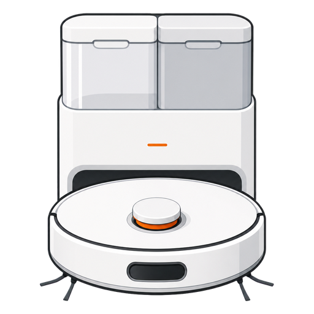

# X20 Max (Smart Service) for Home Assistant

<p align="center">
  
</p>

[](https://hacs.xyz/)
[](https://github.com/SmartServicePL/xiaomi-x20-max/actions/workflows/validate.yml)

Unofficial, model-specific Home Assistant integration for the robot vacuum
model `xiaomi.vacuum.d109gl`.

Not affiliated with, endorsed by or sponsored by Xiaomi. The integration uses
the OAuth client of the official Xiaomi Home integration and is distributed
under the Xiaomi Home license for personal, non-commercial use with Home
Assistant only (see [LICENSE_XIAOMI.md](LICENSE_XIAOMI.md)). Product names are
used only to identify the supported device.

[Polska instrukcja](README_PL.md)

Integration prepared by **Smart Service**.

## Features

- Native vacuum entity: start, pause, stop, locate and return to base.
- Exact room IDs and names from the active map.
- Current location sensor with conservative room detection when the robot exposes
  position data.
- Clean one or multiple rooms by ID or exact name.
- Vacuum/mop mode, suction, water level, 1–3 passes and route selection.
- Omni station actions: empty bin, wash mops and dry mops.
- Battery, cleaning history, faults and consumable-life sensors.
- Controls for carpet handling, obstacle avoidance, DND and detergent.
- Buttons for mapping and resetting consumable counters.
- Advanced raw MIoT property and action services.
- English and Polish translations.

## Requirements

- Home Assistant 2026.7.0 or newer.
- Xiaomi Robot Vacuum X20 Max with model ID `xiaomi.vacuum.d109gl`.
- The robot configured in the Xiaomi Home mobile app.
- The official **Xiaomi Home** integration configured in Home Assistant with
  the same Xiaomi account and region. It supplies the initial OAuth grant.
- Internet access from Home Assistant to `*.ha.api.io.mi.com`.

## Installation with HACS

1. In HACS, open **Integrations**.
2. Open the menu and choose **Custom repositories**.
3. Add `https://github.com/SmartServicePL/xiaomi-x20-max` as an
   **Integration** repository.
4. Install **Xiaomi Robot Vacuum X20 Max**.
5. Restart Home Assistant.
6. Go to **Settings → Devices & services → Add integration**.
7. Search for **Xiaomi Robot Vacuum X20 Max** and select the robot.

If setup reports that OAuth credentials are unavailable, configure or reload
the official Xiaomi Home integration first and retry.

### Re-authentication

This integration has no Xiaomi login of its own; it uses the sign-in of the
official Xiaomi Home integration. If Xiaomi rejects the OAuth grant, the
integration first imports a newer grant from Xiaomi Home automatically. If
that is not possible, Home Assistant shows **Re-authenticate** for the
X20 Max: sign in again in Xiaomi Home (same account and region), then open
the X20 Max re-authentication and select **Submit**.

## Manual installation

Copy `custom_components/xiaomi_x20_max` into the `custom_components`
directory in your Home Assistant configuration, restart Home Assistant and
add the integration from the UI.

## Clean rooms

Room IDs and names are available in the **Rooms** sensor and in the vacuum
entity attributes.

```yaml
action: xiaomi_x20_max.clean_rooms
data:
  entity_id: vacuum.my_x20_max_control
  rooms:
    - Kitchen
    - 10
  mode: vacuum_and_mop
  suction: turbo
  water_level: medium
  passes: 2
  route: careful
```

`rooms` accepts IDs, exact room names, or a mixture of both. IDs are checked
against the robot's active map; if the map has not been loaded, the action
fails instead of sending unchecked IDs.

The action waits until the start is confirmed. The robot answers with a
generic MIoT result that does not tell whether it started, so in that case
the integration reads the robot status and the active task for up to
5 minutes, because with mopping the robot first washes its mops in the
station for about 3 minutes. If the robot does not start (for example no
clean water or a station fault), the action fails as soon as the robot
pauses with a fault code. The error lists the MIoT status and fault codes, so
automations can react to it.

The robot always begins in the room where its station stands: it leaves the
station and plans the route from there, so the station room is cleaned first
even when another room is first in `rooms`. Put the station room first to keep
the order predictable.

During a mopping task the robot drives back to wash its mops (state
`returning`) and washes them in the station (state `cleaning`). The task is
over when the state becomes `docked`. The raw MIoT status is available in the
`miot_status` attribute.

`mode`, `suction`, `water_level`, `passes` and `route` change the robot's
global settings and stay in effect after the run. `vacuum.start`,
`vacuum.clean_area` and schedules in the Xiaomi Home app use those current
settings, so pass them explicitly in every automation that depends on them.

## Clean areas (Home Assistant 2026.3+)

The vacuum entity supports `vacuum.clean_area`. Assign Home Assistant areas
to robot rooms in the settings dialog of the X20 Max vacuum entity.
`clean_area` uses the same room check and start confirmation as
`clean_rooms` and the robot's current mode and suction settings.

When the robot's rooms change (new map, room partition, map switching),
Home Assistant shows a repair issue; open it and assign the areas again.

## Station actions

```yaml
action: xiaomi_x20_max.station_action
data:
  entity_id: vacuum.my_x20_max_control
  action: wash_mops
```

Available actions: `empty`, `wash_mops`, `dry_mops`, `leave_station`,
`stop_washing`, `stop_drying` and `return_to_wash`.

## Maintenance notification blueprint

The optional blueprint creates reusable alerts for station faults, detergent,
mops, filter, brushes and dust bag. Import it once for each robot and select
your own mobile notification action. Notifications are sent only for real
changes, not when a value reappears after a cloud outage, restart or reload.
Notification texts can be English or Polish (option in the blueprint).
Consumable alerts fire when a value crosses its threshold, so a value that is
already below it when the automation is created does not send an alert.

[Import maintenance blueprint](https://my.home-assistant.io/redirect/blueprint_import/?blueprint_url=https%3A%2F%2Fgithub.com%2FSmartServicePL%2Fxiaomi-x20-max%2Fblob%2Fmain%2Fblueprints%2Fautomation%2FSmartServicePL%2Fx20_max_maintenance.yaml)

## Authentication and privacy

On first setup the integration imports an existing Xiaomi OAuth grant from
the official Xiaomi Home integration into its own Home Assistant storage.
After that it refreshes the OAuth token independently. Xiaomi account
passwords and local device tokens are not stored by this integration.

Credentials remain inside Home Assistant and are only sent to Xiaomi Cloud.
Diagnostics redact the cloud device ID and room names.

## Limitations

- Cloud polling; this is not a local integration.
- One Xiaomi OAuth account/region per Home Assistant installation.
- Exact current-room reporting depends on the robot exposing position data. If
  Xiaomi Cloud returns only a cleaning queue, the location sensor reports
  `Unknown` and exposes the queued rooms in attributes.
- The robot is shown as unavailable when Xiaomi Cloud does not answer for
  3 minutes or Xiaomi reports the robot offline (checked every 5 minutes).
- The **Clear map**, **Partition rooms automatically** and **Start quick
  mapping** buttons are disabled by default: they change room IDs used by automations.
  Enable them in the entity settings when needed.
- No map rendering.
- The device does not expose continuous clean/dirty-water percentages.
- Fault codes have no official list. Only codes with a known meaning get a
  text (`fault_code_description` and the Faults sensor); any other code is
  shown as a number.
- `fault_code` is the last fault code the robot reported (MIoT 2.3). It stays
  after the fault is gone, so use it for diagnostics only.
  `fault_code_description` has a value only while that fault is active (the
  code is also in the current fault list); otherwise it is empty.
- Some MIoT properties are undocumented and can change with firmware.

The raw `set_property` and `execute_action` services are intended for advanced
users. Incorrect values may change maps or device settings.

## Support

Open an [issue](https://github.com/SmartServicePL/xiaomi-x20-max/issues) and
attach Home Assistant diagnostics. Never attach `.storage` files or tokens.

## License and disclaimer

MIT licensed. This project is not affiliated with Xiaomi. Xiaomi Cloud API use
is intended only for personal, non-commercial Home Assistant installations;
see [LICENSE_XIAOMI.md](LICENSE_XIAOMI.md).
